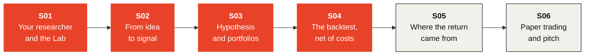

# Investment Bootcamp

### Build one investment strategy. Test the idea correctly.

**English** · [Español](https://github.com/KaxaNuk/Investment-Bootcamp/tree/spanish)

---

In six sessions you build one investment strategy and test the idea correctly, **from a written
claim to a verdict in writing**, with your own KaxaNuk Researcher beside you. The promise is to
test an idea well, with every calculation and every assumption in the open, never better returns.

The Bootcamp is the first of the KaxaNuk Training Workshops, open to everyone. A beginner leaves
with a general idea of the research process and its tools; an advanced user learns them in full.
**Golden-Flow** is the worked example, end to end. The slides quote it rebuilt on the Lab,
US-Golden-Flow; `init-example` copies the version the KaxaNuk Researcher ships, with figures of
its own.

> [!IMPORTANT]
> **S04's slides are out, *Simulate Your Books: the Backtest, Net of Costs*.** S01 to S03 are
> updated too: their figures now come from Golden-Flow rebuilt on the Lab. And S03's recording
> is out, in Spanish: watch it with its slides beside you.

**[▶ Watch S03 · Write Your Hypothesis and Build the Historical Portfolios](https://youtu.be/rT40-64VxgI?t=522)**

[▶ Watch S02 · From Idea to Signal: Objective, Universe and Data](https://youtu.be/rdh02OIDZvE)

[▶ Watch S01 · Create Your Researcher and Learn to Use the Lab](https://youtu.be/g_ETCXjbD0E)

## 🗺️ The path

## 📅 How it works

| | |
| --- | --- |
| 🎥 **Live** | One session a week, online, 60 minutes; its recording is linked here after |
| 📥 **The slides** | Each session's deck is published here the week it is given, in two formats: HTML, interactive, and PDF, to read or print |
| 🛤️ **Two tracks** | No code, in the Investment Lab · or code, on the KaxaNuk Strategy Template |
| 🤖 **Your assistant** | Claude Code on a paid plan · Codex · Cursor · Copilot CLI · Antigravity |

## 🖥️ Open the slides

> [!TIP]
> **The PDF opens right here on GitHub**: click it to read it. **The HTML is the interactive
> deck**, with its animations, and GitHub shows it as code, so download it first.

1. Click the session's HTML file at the top of this page, or its link in the table below.
2. Click **Download raw file**, the download arrow ⤓ at the top right of the file.
3. Double-click the downloaded file. It opens in **Chrome or Edge**, with no internet needed.
4. Move with the **arrow keys**, a **click** or a **presentation clicker**. **F11** shows it full
   screen.

## 📚 The six sessions

| | Session | What you do | You leave with |
| :---: | --- | --- | --- |
| 🟥 | [**S01 · Create Your Researcher and Learn to Use the Lab**](S01%20Create%20Your%20Researcher%20and%20Learn%20to%20Use%20the%20Lab.html) **Available** · [Video](https://youtu.be/g_ETCXjbD0E) · [HTML](S01%20Create%20Your%20Researcher%20and%20Learn%20to%20Use%20the%20Lab.html) · [PDF](S01%20Create%20Your%20Researcher%20and%20Learn%20to%20Use%20the%20Lab.pdf) | Install your researcher and train it with papers. Meet the Investment Lab, and see each part of a strategy on Golden-Flow. | Your researcher, named · your first cited note · an idea to test |
| 🟥 | [**S02 · From Idea to Signal: Objective, Universe and Data**](S02%20From%20Idea%20to%20Signal%20-%20Objective%2C%20Universe%20and%20Data.html) **Available** · [Video](https://youtu.be/rdh02OIDZvE) · [HTML](S02%20From%20Idea%20to%20Signal%20-%20Objective%2C%20Universe%20and%20Data.html) · [PDF](S02%20From%20Idea%20to%20Signal%20-%20Objective%2C%20Universe%20and%20Data.pdf) | Write your strategy's idea and its claims, with papers for and against. Build its universe with the dead stocks kept, download the data and analyze your signal before any portfolio. | Your `OBJECTIVE.md` · your universe · your data · your signal, analyzed |
| 🟥 | [**S03 · Write Your Hypothesis and Build the Historical Portfolios**](S03%20Write%20Your%20Hypothesis%20and%20Build%20the%20Historical%20Portfolios.html) **Available** · [Video](https://youtu.be/rT40-64VxgI?t=522) · [HTML](S03%20Write%20Your%20Hypothesis%20and%20Build%20the%20Historical%20Portfolios.html) · [PDF](S03%20Write%20Your%20Hypothesis%20and%20Build%20the%20Historical%20Portfolios.pdf) | Write your experiment 1 hypothesis before the rule. Build your historical books with what was known each day: point in time, corporate events and sectors. | Your blueprint · your rule and its control · your books |
| 🟥 | [**S04 · Simulate Your Books: the Backtest, Net of Costs**](S04%20Simulate%20Your%20Books%20-%20the%20Backtest%2C%20Net%20of%20Costs.html) **Available** · [HTML](S04%20Simulate%20Your%20Books%20-%20the%20Backtest%2C%20Net%20of%20Costs.html) · [PDF](S04%20Simulate%20Your%20Books%20-%20the%20Backtest%2C%20Net%20of%20Costs.pdf) | Turn your books into a track record with the Backtest Engine, net of costs, against your control, the KN US Equity Core and SPY. Read it by period, and take a first look at factor models. | Your track record · your `FINDINGS_1.md` |
| ⬜ | **S05 · Attribute Its Return: Where It Came From** Week 5 | Split your track record by sector and by factor against the KN US Equity Core: what the market paid, and what is your rule's own. | Where its return came from · your `RESULTS.md` |
| ⬜ | **S06 · Paper Trading and Your Strategy's Pitch** Week 6 | Read your strategy against the gate, in two layers, and learn how a book is frozen and run on paper. Present it in your own deck. | Your verdict, in writing · your pitch |

## 💬 Questions

Ask your researcher first: say *"I'm on Bootcamp S04"*. Then write to
[workshops@kaxanuk.mx](mailto:workshops@kaxanuk.mx).

---

KaxaNuk's Researcher, Data Curator and Strategy Template are open source; the Investment Lab
and the Analytics Factory are by subscription. Nothing here is a recommendation to buy, sell or
hold any security. Backtests are hypothetical and in sample. The material is shared under
CC BY 4.0; the KaxaNuk name, logo and isotipo are not.
