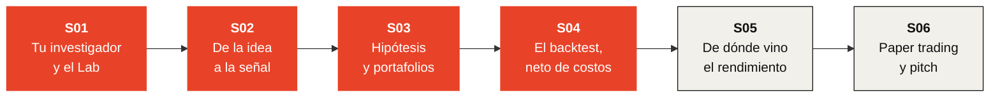

# Investment Bootcamp

### Construye una estrategia de inversión. Prueba bien la idea.

[English](https://github.com/KaxaNuk/Investment-Bootcamp/tree/english) · **Español**

---

En seis sesiones construyes una estrategia de inversión y pruebas la idea correctamente, **desde
una afirmación escrita hasta un veredicto por escrito**, con tu propio KaxaNuk Researcher a tu
lado. La promesa es probar bien una idea, con cada cálculo y cada supuesto a la vista, nunca mejores
rendimientos.

El Bootcamp es el primero de los KaxaNuk Training Workshops, abierto a todos. Quien empieza se
lleva una idea general del proceso de investigación y sus herramientas; quien ya sabe, las aprende
a fondo. **Golden-Flow** es el ejemplo, de principio a fin. Las slides lo citan reconstruido en el
Lab, US-Golden-Flow; `init-example` copia la versión que distribuye el KaxaNuk Researcher, con sus
propias cifras.

> [!IMPORTANT]
> **El Bootcamp ahora tiene seis sesiones:** la S05 es la atribución, y la S06 el paper trading
> y el pitch de tu estrategia. **Ya están las slides de la S04:** *Simula tus portafolios: el
> backtest, neto de costos*. La S01, la S02 y la S03 también se actualizaron: sus cifras vienen de
> Golden-Flow reconstruido en el Lab, y cada sesión nombra la documentación de su librería. Ya está
> la grabación de la S03: mírala con sus slides al lado.

**[▶ Mira la S03 · Escribe tu hipótesis y construye los portafolios históricos](https://youtu.be/rT40-64VxgI?t=522)**

[▶ Mira la S02 · De la idea a la señal: objetivo, universo y datos](https://youtu.be/rdh02OIDZvE)

[▶ Mira la S01 · Crea tu investigador y aprende a usar el Lab](https://youtu.be/g_ETCXjbD0E)

## 🗺️ El recorrido

## 📅 Cómo funciona

| | |
| --- | --- |
| 🎥 **En vivo** | Una sesión por semana, en línea, de 60 minutos; después, su grabación se enlaza aquí |
| 📥 **Las slides** | La presentación de cada sesión se publica aquí la semana en que se da, en dos formatos: HTML, interactivo, y PDF, para leer o imprimir |
| 🛤️ **Dos rutas** | Sin código, en el Investment Lab · o con código, en el KaxaNuk Strategy Template |
| 🤖 **Tu asistente** | Claude Code con plan de pago · Codex · Cursor · Copilot CLI · Antigravity |

## 🖥️ Abre las slides

> [!TIP]
> **El PDF se abre aquí mismo en GitHub**: haz clic para leerlo. **El HTML es la presentación
> interactiva**, con sus animaciones, y GitHub lo muestra como código, así que primero descárgalo.

1. Haz clic en el archivo HTML de la sesión, arriba en esta página, o en su enlace en la tabla de
   abajo.
2. Haz clic en **Download raw file**, la flecha de descarga ⤓ arriba a la derecha del archivo.
3. Abre el archivo descargado con doble clic. Se abre en **Chrome o Edge**, sin necesidad de
   internet.
4. Avanza con las **flechas del teclado**, con un **clic** o con un **clicker de presentación**.
   **F11** lo muestra en pantalla completa.

## 📚 Las seis sesiones

| | Sesión | Qué haces | Con qué te vas |
| :---: | --- | --- | --- |
| 🟥 | [**S01 · Crea tu investigador y aprende a usar el Lab**](S01%20Crea%20tu%20investigador%20y%20aprende%20a%20usar%20el%20Lab.html) **Disponible** · [Video](https://youtu.be/g_ETCXjbD0E) · [HTML](S01%20Crea%20tu%20investigador%20y%20aprende%20a%20usar%20el%20Lab.html) · [PDF](S01%20Crea%20tu%20investigador%20y%20aprende%20a%20usar%20el%20Lab.pdf) | Instalas tu investigador y lo entrenas con papers. Conoces el Investment Lab y ves cada parte de una estrategia en Golden-Flow. | Tu investigador, con nombre · tu primera nota citada · una idea que probar |
| 🟥 | [**S02 · De la idea a la señal: objetivo, universo y datos**](S02%20De%20la%20idea%20a%20la%20se%C3%B1al%20-%20objetivo%2C%20universo%20y%20datos.html) **Disponible** · [Video](https://youtu.be/rdh02OIDZvE) · [HTML](S02%20De%20la%20idea%20a%20la%20se%C3%B1al%20-%20objetivo%2C%20universo%20y%20datos.html) · [PDF](S02%20De%20la%20idea%20a%20la%20se%C3%B1al%20-%20objetivo%2C%20universo%20y%20datos.pdf) | Escribes la idea de tu estrategia y sus afirmaciones, con papers a favor y en contra. Construyes su universo con las empresas que dejaron de cotizar, descargas los datos y analizas tu señal antes de cualquier portafolio. | Tu `OBJECTIVE.md` · tu universo · tus datos · tu señal analizada |
| 🟥 | [**S03 · Escribe tu hipótesis y construye los portafolios históricos**](S03%20Escribe%20tu%20hip%C3%B3tesis%20y%20construye%20los%20portafolios%20hist%C3%B3ricos.html) **Disponible** · [Video](https://youtu.be/rT40-64VxgI?t=522) · [HTML](S03%20Escribe%20tu%20hip%C3%B3tesis%20y%20construye%20los%20portafolios%20hist%C3%B3ricos.html) · [PDF](S03%20Escribe%20tu%20hip%C3%B3tesis%20y%20construye%20los%20portafolios%20hist%C3%B3ricos.pdf) | Escribes la hipótesis de tu experimento 1 antes de la regla. Construyes tus portafolios históricos con lo que se sabía cada día: point in time, eventos corporativos y sectores. | Tu blueprint · tu regla y su control · tus portafolios |
| 🟥 | [**S04 · Simula tus portafolios: el backtest, neto de costos**](S04%20Simula%20tus%20portafolios%20-%20el%20backtest%2C%20neto%20de%20costos.html) **Disponible** · [HTML](S04%20Simula%20tus%20portafolios%20-%20el%20backtest%2C%20neto%20de%20costos.html) · [PDF](S04%20Simula%20tus%20portafolios%20-%20el%20backtest%2C%20neto%20de%20costos.pdf) | Conviertes tus portafolios en un historial con el Backtest Engine, neto de costos, contra tu control, el KN US Equity Core y SPY. Lo lees por periodo y das un primer vistazo a los modelos de factores. | Tu historial · tu `FINDINGS_1.md` |
| ⬜ | **S05 · Atribuye su rendimiento: de dónde vino** Semana 5 | Repartes tu historial por sector y por factor contra el KN US Equity Core: lo que pagó el mercado, y lo que es propio de tu regla. | De dónde vino su rendimiento · tu `RESULTS.md` |
| ⬜ | **S06 · Paper trading y el pitch de tu estrategia** Semana 6 | Lees tu estrategia contra el filtro, en dos capas, y aprendes cómo se congela un portafolio y se corre en papel. La presentas en tu propia presentación. | Tu veredicto, por escrito · tu pitch |

## S01 · Crea tu investigador y aprende a usar el Lab

- **Objetivo.** Instalas tu investigador, lo entrenas con papers, construyes con él una primera
  herramienta y conoces el Investment Lab, paso a paso, con Golden-Flow.
- **Te vas con:** tu investigador, con nombre; tu primera nota citada; una idea que probar.
- **Evaluación, sin IA:** qué hace tuyo a tu investigador; qué dice tu simulador, y qué no dice;
  cómo lo entrenas; qué hace el Lab, paso a paso.
- **Antes, si empiezas de cero:** CF P01 *Your Computer, Your Folders, Your Researcher*; CF P02
  *Ask Your AI Well*; FM P01 *Stock, ETF, Index and Benchmark*.

## S02 · De la idea a la señal: objetivo, universo y datos

- **Objetivo.** Escribes la idea de tu estrategia y sus afirmaciones, con papers a favor y en
  contra; construyes su universo con las empresas que dejaron de cotizar; descargas los datos y
  analizas tu señal antes de cualquier portafolio.
- **Te vas con:** tu `OBJECTIVE.md`; tu universo; tus datos; tu señal analizada.
- **Evaluación, sin IA:** qué afirma tu idea, y qué pregunta lo resolvería; qué paper la apoya, y
  cuál la contradice; por qué conservas las que salieron de bolsa; para qué sirve el Data Analyzer.
- **Antes, si empiezas de cero:** CF P03 *Ask Your Table Questions*; MF P01 *Averages, Percentages
  and the Log Scale*; FM P06 *Don't Fool Yourself*.

## S03 · Escribe tu hipótesis y construye los portafolios históricos

- **Objetivo.** Escribes la hipótesis de tu experimento 1 antes de la regla, y construyes tus
  portafolios históricos solo con lo que se sabía cada día: point in time, eventos corporativos y
  sectores.
- **Te vas con:** tu blueprint; tu regla y su control; tus portafolios.
- **Evaluación, sin IA:** por qué la hipótesis va antes de la regla; quién, cuánto y cuándo; qué es
  point in time; qué hacer con un split, una compra o un ticker reciclado.
- **Antes, si empiezas de cero:** FM P04 *How the Market Works: What a Trade Costs*; MF P02 *How
  Much It Spreads*; CF P05 *From a Chat to a Script You Can Run Again*.

## S04 · Simula tus portafolios: el backtest, neto de costos

- **Objetivo.** Conviertes tus portafolios en un historial con el Backtest Engine, neto de costos,
  contra tu control, el KN US Equity Core y SPY; lo lees por periodo y das un primer vistazo a los
  modelos de factores.
- **Te vas con:** tu historial; tu `FINDINGS_1.md`.
- **Evaluación, sin IA:** qué hace el motor con tus pesos; por qué neto de costos; contra quién se
  compara; qué es un modelo de factores.
- **Antes, si empiezas de cero:** FM P05 *What a Strategy Is, and Who It Must Beat*; MF P03 *Do
  They Move Together?*; MF P04 *Chance: the Normal Curve and Fat Tails*.

## S05 · Atribuye su rendimiento: de dónde vino

- **Objetivo.** Repartes tu historial por sector y por factor contra el KN US Equity Core, con
  Attribution Analysis: lo que pagó el mercado, lo que pagaron los estilos y los sectores, y lo que
  es propio de tu regla.
- **Te vas con:** de dónde vino su rendimiento, en dos capas y una pasada; tu `RESULTS.md`.
- **Evaluación, sin IA:** qué responde cada capa; por qué un modelo de factores no ve una regla
  absoluta, y qué la ve; qué movió el residuo; qué pide el P2 del filtro.
- **Antes, si empiezas de cero:** FM P05 *What a Strategy Is, and Who It Must Beat*; MF P03 *Do
  They Move Together?*; MF P04 *Chance: the Normal Curve and Fat Tails*.

## S06 · Paper trading y el pitch de tu estrategia

- **Objetivo.** Lees tu estrategia contra el filtro de graduación, en dos capas; aprendes cómo se
  congela un portafolio y se corre en papel, y qué se vigila fuera de muestra; presentas tu
  estrategia en tu propia presentación.
- **Te vas con:** tu veredicto, por escrito; tu pitch.
- **Evaluación, sin IA:** las dos capas del filtro, y por qué en ese orden; qué permite cada
  desenlace; qué se congela, y por qué nada se reajusta; qué va junto a cada cifra de tu pitch.
- **Antes, si empiezas de cero:** MF P05 *Luck or Skill?*; MF P06 *Models and Their Error*; CF P06
  *Save Your Versions, Share Your Work*.

## Qué necesitas y cuánto cuesta

Para instalar tu investigador solo necesitas un asistente de código. Lo demás lo eliges tú: las
herramientas son opciones, y tus archivos son los mismos con cualquiera.

| Para | Opciones | Cuánto cuesta, leído el 2026-10-11 |
| --- | --- | --- |
| Tu asistente | Claude Code | un plan de pago de Claude: Pro, $20 al mes, o $17 al mes con pago anual; Max desde $100 al mes; el plan gratuito no incluye Claude Code |
| | Codex | en todos los planes de ChatGPT, el gratuito incluido (el gratuito no se ha probado con esta instalación); Go, $8 al mes; Plus, $20 al mes; o una llave de API a precios de API |
| Tu editor | PyCharm o VS Code | gratis: el núcleo de PyCharm, con 30 días de prueba de Pro; VS Code |
| Versiones y la vista de la biblioteca | GitHub Desktop, git, Obsidian | gratis; una cuenta de GitHub, gratis, solo para el respaldo |
| Datos | Yahoo Finance, FMP, LSEG | ve los [proveedores del Data Curator](https://kaxanuk-data-curator.readthedocs.io) |
| Sin código, y los motores | el Investment Lab | por suscripción: lab@kaxanuk.mx |
| Opcional | la Analytics Factory | por suscripción; una muestra por correo: analytics@kaxanuk.mx |

Yahoo Finance no tiene estados financieros, VWAP ni precios sin ajustar, así que un backtest con
sus datos es impreciso. Desde la S04 las dos rutas usan los motores del Investment Lab; sin
licencia, sigues de la S04 a la S06 con las cifras de las sesiones. Cada librería documenta su
método: [Data Curator](https://kaxanuk-data-curator.readthedocs.io/en/latest/),
[Backtest Engine](https://kaxanuk-backtest-engine.readthedocs-hosted.com/en/latest/),
[Attribution Analysis](https://kaxanuk-attribution-analysis.readthedocs-hosted.com/en/latest/).
Los precios cambian: revisa cada página antes de pagar.

## El día de presentación y la evaluación

Cuando un grupo tiene un día de presentación después de la S06, cada participante presenta el
pitch que prepara en la S06.

- **Diez minutos ante un comité**, cada parte desde un archivo: la hipótesis y por qué debería
  funcionar (`OBJECTIVE.md`); el universo y el benchmark, con las empresas que dejaron de cotizar
  (`Universe/`); la regla y su control, guardados antes (`BLUEPRINT_1.md`); neto, contra el control
  y el benchmark, con N, y de dónde vino (`FINDINGS_1.md`); el filtro, y lo que sigue
  (`FINDINGS_1.md`, `RESULTS.md`).
- **Se califica con la rúbrica de 3x3:** tres áreas (definición de la estrategia, ingeniería de
  variables, diseño de la estrategia), tres filas cada una, cada fila con 0, 33, 66 o 100. **No hay
  fila para el rendimiento.**
- **Revisiones del proceso, aprobado o no:** los resultados se reproducen; el blueprint se guarda
  antes de la regla; cada cifra lleva a un archivo; el número de intentos se publica; el filtro se
  lee con evidencia, fila por fila. Un no, medido, contado y explicado, califica igual que un sí.
- **Los certificados** se dan solo en una defensa en vivo. Un certificado dice que se completó un
  programa educativo, nunca que alguien está calificado para administrar dinero.

## Para ir más a fondo: los tres pilares

Tres talleres pilares van más a fondo, después del Bootcamp o a la par, y se abren conforme se
publica cada uno:

- **Coding Foundations:** programar, y programar con IA.
- **Financial Markets:** los mercados, las ideas de investigación y los datos de la Analytics
  Factory.
- **Mathematical Finance:** las matemáticas y la estadística de la investigación.

Una regla recorre los cuatro talleres: escribe lo que esperas, guárdalo, y luego haz el trabajo.

## 💬 Preguntas

Pregúntale primero a tu investigador: dile *"voy en la S04 del Bootcamp"*. Luego escribe a
[workshops@kaxanuk.mx](mailto:workshops@kaxanuk.mx).

---

El Researcher, el Data Curator y el Strategy Template de KaxaNuk son open source; el
Investment Lab y el Analytics Factory son por suscripción. Nada aquí es una recomendación para
comprar, vender o mantener ningún valor. Los backtests son hipotéticos y dentro de muestra. El
material se comparte bajo CC BY 4.0; el nombre, el logo y el isotipo de KaxaNuk no.
