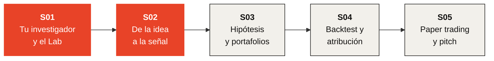

# Investment Bootcamp

### Construye una estrategia de inversión. Prueba bien la idea.

[English](https://github.com/KaxaNuk/Investment-Bootcamp/tree/english) · **Español**

---

En cinco sesiones construyes una estrategia de inversión y pruebas la idea correctamente, **desde
una afirmación escrita hasta un veredicto por escrito**, con tu propio KaxaNuk Researcher a tu
lado. La promesa es probar bien una idea, con cada cálculo y cada supuesto a la vista, nunca mejores
rendimientos.

El Bootcamp es el primero de los KaxaNuk Training Workshops, abierto a todos. Quien empieza se
lleva una idea general del proceso de investigación y sus herramientas; quien ya sabe, las aprende
a fondo. **Golden-Flow** es el ejemplo, de principio a fin.

> [!IMPORTANT]
> **Ya está la grabación de la S02, *De la idea a la señal*.** Mírala con sus slides al lado.

**[▶ Mira la S02 · De la idea a la señal: objetivo, universo y datos](https://youtu.be/rdh02OIDZvE)**

[▶ Mira la S01 · Crea tu investigador y aprende a usar el Lab](https://youtu.be/g_ETCXjbD0E)

## 🗺️ El recorrido

## 📅 Cómo funciona

| | |
| --- | --- |
| 🎥 **En vivo** | Una sesión por semana, en línea, de 60 minutos; después, su grabación se enlaza aquí |
| 📥 **Las slides** | La presentación de cada sesión se publica aquí la semana en que se da, en dos formatos: HTML, interactivo, y PDF, para leer o imprimir |
| 🛤️ **Dos rutas** | Sin código, en el Investment Lab · o con código, en el KaxaNuk Strategy Template |
| 🤖 **Tu asistente** | Claude Code con plan de pago · Codex · Cursor · Copilot CLI · Antigravity |

## 🖥️ Abre las slides

> [!TIP]
> **El PDF se abre aquí mismo en GitHub**: haz clic para leerlo. **El HTML es la presentación
> interactiva**, con sus animaciones, y GitHub lo muestra como código, así que primero descárgalo.

1. Haz clic en el archivo HTML de la sesión, arriba en esta página, o en su enlace en la tabla de
   abajo.
2. Haz clic en **Download raw file**, la flecha de descarga ⤓ arriba a la derecha del archivo.
3. Abre el archivo descargado con doble clic. Se abre en **Chrome o Edge**, sin necesidad de
   internet.
4. Avanza con las **flechas del teclado**, con un **clic** o con un **clicker de presentación**.
   **F11** lo muestra en pantalla completa.

## 📚 Las cinco sesiones

| | Sesión | Qué haces | Con qué te vas |
| :---: | --- | --- | --- |
| 🟥 | [**S01 · Crea tu investigador y aprende a usar el Lab**](S01%20Crea%20tu%20investigador%20y%20aprende%20a%20usar%20el%20Lab.html) **Disponible** · [Video](https://youtu.be/g_ETCXjbD0E) · [HTML](S01%20Crea%20tu%20investigador%20y%20aprende%20a%20usar%20el%20Lab.html) · [PDF](S01%20Crea%20tu%20investigador%20y%20aprende%20a%20usar%20el%20Lab.pdf) | Instalas tu investigador y lo entrenas con papers. Conoces el Investment Lab y ves cada parte de una estrategia en Golden-Flow. | Tu investigador, con nombre · tu primera nota citada · una idea que probar |
| 🟥 | [**S02 · De la idea a la señal: objetivo, universo y datos**](S02%20De%20la%20idea%20a%20la%20se%C3%B1al%20-%20objetivo%2C%20universo%20y%20datos.html) **Disponible** · [Video](https://youtu.be/rdh02OIDZvE) · [HTML](S02%20De%20la%20idea%20a%20la%20se%C3%B1al%20-%20objetivo%2C%20universo%20y%20datos.html) · [PDF](S02%20De%20la%20idea%20a%20la%20se%C3%B1al%20-%20objetivo%2C%20universo%20y%20datos.pdf) | Escribes la idea de tu estrategia y sus afirmaciones, con papers a favor y en contra. Construyes su universo con las empresas que dejaron de cotizar, descargas los datos y analizas tu señal antes de cualquier portafolio. | Tu `OBJECTIVE.md` · tu universo · tus datos · tu señal analizada |
| ⬜ | **S03 · Escribe tu hipótesis y construye los portafolios históricos** Semana 3 | Guardas una hipótesis refutable antes de la regla. Construyes portafolios históricos solo con lo que se sabía cada día. | Tu blueprint · tu regla y su control |
| ⬜ | **S04 · Simula tus portafolios y atribuye su rendimiento** Semana 4 | Haces el backtest neto de costos contra el KN US Equity Core y SPY. Atribuyes cada punto a factores y sectores. | Tu historial · de dónde vino su rendimiento |
| ⬜ | **S05 · ¿Lista para paper trading? Valida, congela y presenta** Semana 5 | Analizas una estrategia en toda la ventana, por periodo y por factor. Decides cuándo usarla, a discreción o con una regla, y la congelas para paper trading. | Tu veredicto, por escrito · tu portafolio congelado |

## 💬 Preguntas

Pregúntale primero a tu investigador: dile *"voy en la S02 del Bootcamp"*. Luego escribe a
[workshops@kaxanuk.mx](mailto:workshops@kaxanuk.mx).

---

El Researcher, el Data Curator y el Strategy Template de KaxaNuk son open source; el
Investment Lab y el Analytics Factory son por suscripción. Nada aquí es una recomendación para
comprar, vender o mantener ningún valor. Los backtests son hipotéticos y dentro de muestra. El
material se comparte bajo CC BY 4.0; el nombre, el logo y el isotipo de KaxaNuk no.
