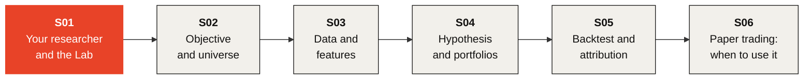

# Investment Bootcamp

### Build one investment strategy. Test the idea correctly.

**English** · [Español](https://github.com/KaxaNuk/Investment-Bootcamp/tree/spanish)

---

In six sessions you build one investment strategy and test the idea correctly, **from a written
claim to a verdict in writing**, with your own KaxaNuk Researcher beside you. The promise is to
test an idea well, never better returns.

The Bootcamp is the first of the KaxaNuk Training Workshops, open to everyone. A beginner leaves
with a general idea of the research process and its tools; an advanced user learns them in full.
**Golden-Flow** is the worked example, end to end.

> [!IMPORTANT]
> **S01 is live on Wednesday 2026-11-04 at 10:00, Mexico City time.**
> [Register on Luma →](https://luma.com/houg6p99)

## 🗺️ The path

## 📅 How it works

| | |
| --- | --- |
| 🎥 **Live** | One session a week, online, 90 minutes |
| 📥 **The slides** | Each session's deck is published here the week it is given, as one HTML file |
| 🛤️ **Two tracks** | No code, in the Investment Lab · or code, on the KaxaNuk Strategy Template |
| 🤖 **Your assistant** | Claude Code on a paid plan · Codex · Cursor · Copilot CLI · Antigravity |

## 🖥️ Open the slides

> [!TIP]
> GitHub shows an HTML file as code, not as slides. **Download it, then open it.**

1. Click the session's file at the top of this page, or its link in the table below.
2. Click **Download raw file**, the download arrow ⤓ at the top right of the file.
3. Double-click the downloaded file. It opens in **Chrome or Edge**, with no internet needed.
4. Move with the **arrow keys**, a **click** or a **presentation clicker**. **F11** shows it full
   screen.

## 📚 The six sessions

| | Session | What you do | You leave with |
| :---: | --- | --- | --- |
| 🟥 | [**S01 · Create Your Researcher and Learn to Use the Lab**](S01%20Create%20Your%20Researcher%20and%20Learn%20to%20Use%20the%20Lab.html) **Available** | Install your researcher and train it with papers. Meet the Investment Lab, and see each part of a strategy on Golden-Flow. | Your researcher, named · your first cited note · an idea to test |
| ⬜ | **S02 · Your Strategy's Objective and the Investable Universe** Week 2 | Start your strategy, write its objective and choose its benchmark first. Build a universe as it was on each date, the dead stocks kept. | Your repository · your `OBJECTIVE.md` · your universe |
| ⬜ | **S03 · Getting the Data and Feature Engineering** Week 3 | Download your data and build features. Analyze a signal on its own, before any portfolio. | Your data · a signal kept or dropped |
| ⬜ | **S04 · Write Your Hypothesis and Build the Historical Portfolios** Week 4 | Save a refutable hypothesis before the rule. Build historical books with only what was known each day. | Your blueprint · your rule and its control |
| ⬜ | **S05 · Simulate Your Books and Attribute Their Return** Week 5 | Backtest net of costs against the KN US Equity Core and SPY. Attribute every point to factors and sectors. | Your track record · where its return came from |
| ⬜ | **S06 · Ready for Paper Trading? Validate, Freeze and Present** Week 6 | Analyze a strategy over the whole window, by period and by factor. Decide when to use it, at discretion or by a rule, and freeze it for paper trading. | Your verdict, in writing · your frozen book |

## 💬 Questions

Ask your researcher first: say *"I'm on Bootcamp S01"*. Then write to
[workshops@kaxanuk.mx](mailto:workshops@kaxanuk.mx).

---

KaxaNuk's Researcher, Data Curator and Strategy Template are open source; the Investment Lab
and the Analytics Factory are by subscription. Nothing here is a recommendation to buy, sell or
hold any security. Backtests are hypothetical and in sample. The material is shared under
CC BY 4.0; the KaxaNuk name, logo and isotipo are not.
