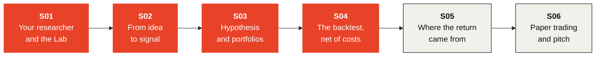

# Investment Bootcamp

### Build one investment strategy. Test the idea correctly.

**English** · [Español](https://github.com/KaxaNuk/Investment-Bootcamp/tree/spanish)

---

In six sessions you build one investment strategy and test the idea correctly, **from a written
claim to a verdict in writing**, with your own KaxaNuk Researcher beside you. The promise is to
test an idea well, with every calculation and every assumption in the open, never better returns.

The Bootcamp is the first of the KaxaNuk Training Workshops, open to everyone. A beginner leaves
with a general idea of the research process and its tools; an advanced user learns them in full.
**Golden-Flow** is the worked example, end to end. The slides quote it rebuilt on the Lab,
US-Golden-Flow; `init-example` copies the version the KaxaNuk Researcher ships, with figures of
its own.

> [!IMPORTANT]
> **The Bootcamp now has six sessions:** S05 is attribution, and S06 paper trading and your
> strategy's pitch. **S04's slides are out:** *Simulate Your Books: the Backtest, Net of Costs*. S01
> to S03 are updated too: their figures come from Golden-Flow rebuilt on the Lab. S03's recording is out, in Spanish: watch it with its slides
> beside you.

**[▶ Watch S03 · Write Your Hypothesis and Build the Historical Portfolios](https://youtu.be/rT40-64VxgI?t=522)**

[▶ Watch S02 · From Idea to Signal: Objective, Universe and Data](https://youtu.be/rdh02OIDZvE)

[▶ Watch S01 · Create Your Researcher and Learn to Use the Lab](https://youtu.be/g_ETCXjbD0E)

## 🗺️ The path

## 📅 How it works

| | |
| --- | --- |
| 🎥 **Live** | One session a week, online, 60 minutes; its recording is linked here after |
| 📥 **The slides** | Each session's deck is published here the week it is given, in two formats: HTML, interactive, and PDF, to read or print |
| 🛤️ **Two tracks** | No code, in the Investment Lab · or code, on the KaxaNuk Strategy Template |
| 🤖 **Your assistant** | Claude Code on a paid plan · Codex · Cursor · Copilot CLI · Antigravity |

## 🖥️ Open the slides

> [!TIP]
> **The PDF opens right here on GitHub**: click it to read it. **The HTML is the interactive
> deck**, with its animations, and GitHub shows it as code, so download it first.

1. Click the session's HTML file at the top of this page, or its link in the table below.
2. Click **Download raw file**, the download arrow ⤓ at the top right of the file.
3. Double-click the downloaded file. It opens in **Chrome or Edge**, with no internet needed.
4. Move with the **arrow keys**, a **click** or a **presentation clicker**. **F11** shows it full
   screen.

## 📚 The six sessions

| | Session | What you do | You leave with |
| :---: | --- | --- | --- |
| 🟥 | [**S01 · Create Your Researcher and Learn to Use the Lab**](S01%20Create%20Your%20Researcher%20and%20Learn%20to%20Use%20the%20Lab.html) **Available** · [Video](https://youtu.be/g_ETCXjbD0E) · [HTML](S01%20Create%20Your%20Researcher%20and%20Learn%20to%20Use%20the%20Lab.html) · [PDF](S01%20Create%20Your%20Researcher%20and%20Learn%20to%20Use%20the%20Lab.pdf) | Install your researcher and train it with papers. Meet the Investment Lab, and see each part of a strategy on Golden-Flow. | Your researcher, named · your first cited note · an idea to test |
| 🟥 | [**S02 · From Idea to Signal: Objective, Universe and Data**](S02%20From%20Idea%20to%20Signal%20-%20Objective%2C%20Universe%20and%20Data.html) **Available** · [Video](https://youtu.be/rdh02OIDZvE) · [HTML](S02%20From%20Idea%20to%20Signal%20-%20Objective%2C%20Universe%20and%20Data.html) · [PDF](S02%20From%20Idea%20to%20Signal%20-%20Objective%2C%20Universe%20and%20Data.pdf) | Write your strategy's idea and its claims, with papers for and against. Build its universe with the dead stocks kept, download the data and analyze your signal before any portfolio. | Your `OBJECTIVE.md` · your universe · your data · your signal, analyzed |
| 🟥 | [**S03 · Write Your Hypothesis and Build the Historical Portfolios**](S03%20Write%20Your%20Hypothesis%20and%20Build%20the%20Historical%20Portfolios.html) **Available** · [Video](https://youtu.be/rT40-64VxgI?t=522) · [HTML](S03%20Write%20Your%20Hypothesis%20and%20Build%20the%20Historical%20Portfolios.html) · [PDF](S03%20Write%20Your%20Hypothesis%20and%20Build%20the%20Historical%20Portfolios.pdf) | Write your experiment 1 hypothesis before the rule. Build your historical books with what was known each day: point in time, corporate events and sectors. | Your blueprint · your rule and its control · your books |
| 🟥 | [**S04 · Simulate Your Books: the Backtest, Net of Costs**](S04%20Simulate%20Your%20Books%20-%20the%20Backtest%2C%20Net%20of%20Costs.html) **Available** · [HTML](S04%20Simulate%20Your%20Books%20-%20the%20Backtest%2C%20Net%20of%20Costs.html) · [PDF](S04%20Simulate%20Your%20Books%20-%20the%20Backtest%2C%20Net%20of%20Costs.pdf) | Turn your books into a track record with the Backtest Engine, net of costs, against your control, the KN US Equity Core and SPY. Read it by period, and take a first look at factor models. | Your track record · your `FINDINGS_1.md` |
| ⬜ | **S05 · Attribute Its Return: Where It Came From** Week 5 | Split your track record by sector and by factor against the KN US Equity Core: what the market paid, and what is your rule's own. | Where its return came from · your `RESULTS.md` |
| ⬜ | **S06 · Paper Trading and Your Strategy's Pitch** Week 6 | Read your strategy against the gate, in two layers, and learn how a book is frozen and run on paper. Present it in your own deck. | Your verdict, in writing · your pitch |

## S01 · Create Your Researcher and Learn to Use the Lab

- **Goal.** Install your researcher, train it with papers, build a first tool with it, and meet the
  Investment Lab, step by step, on Golden-Flow.
- **You leave with:** your researcher, named; your first cited note; an idea to test.
- **Checkpoint, AI off:** what makes your researcher yours; what your simulator says, and does not
  say; how you train it; what the Lab does, step by step.
- **Before it, if you start from zero:** CF P01 *Your Computer, Your Folders, Your Researcher*; CF
  P02 *Ask Your AI Well*; FM P01 *Stock, ETF, Index and Benchmark*.

## S02 · From Idea to Signal: Objective, Universe and Data

- **Goal.** Write your strategy's idea and its claims, with papers for and against; build its
  universe with the stocks that left the market; download the data and analyze your signal before
  any portfolio.
- **You leave with:** your `OBJECTIVE.md`; your universe; your data; your signal, analyzed.
- **Checkpoint, AI off:** what your idea claims, and what would settle it; which paper supports it,
  and which contradicts it; why you keep the names that left the market; what the Data Analyzer is
  for.
- **Before it, if you start from zero:** CF P03 *Ask Your Table Questions*; MF P01 *Averages,
  Percentages and the Log Scale*; FM P06 *Don't Fool Yourself*.

## S03 · Write Your Hypothesis and Build the Historical Portfolios

- **Goal.** Write your experiment 1 hypothesis before the rule, then build your historical books
  with only what was known each day: point in time, corporate events and sectors.
- **You leave with:** your blueprint; your rule and its control; your books.
- **Checkpoint, AI off:** why the hypothesis comes before the rule; who, how much and when; what
  point in time means; what to do with a split, a buyout or a recycled ticker.
- **Before it, if you start from zero:** FM P04 *How the Market Works: What a Trade Costs*; MF P02
  *How Much It Spreads*; CF P05 *From a Chat to a Script You Can Run Again*.

## S04 · Simulate Your Books: the Backtest, Net of Costs

- **Goal.** Turn your books into a track record with the Backtest Engine, net of costs, against
  your control, the KN US Equity Core and SPY; read it by period, and take a first look at factor
  models.
- **You leave with:** your track record; your `FINDINGS_1.md`.
- **Checkpoint, AI off:** what the engine does with your weights; why net of costs; against whom it
  is compared; what a factor model is.
- **Before it, if you start from zero:** FM P05 *What a Strategy Is, and Who It Must Beat*; MF P03
  *Do They Move Together?*; MF P04 *Chance: the Normal Curve and Fat Tails*.

## S05 · Attribute Its Return: Where It Came From

- **Goal.** Split your track record by sector and by factor against the KN US Equity Core, with
  Attribution Analysis: what the market paid, what the styles and sectors paid, and what is your
  rule's own.
- **You leave with:** where its return came from, in two layers and a pass; your `RESULTS.md`.
- **Checkpoint, AI off:** what each layer answers; why a factor model cannot see an absolute rule,
  and what does; what moved the residual; what the gate's P2 asks.
- **Before it, if you start from zero:** FM P05 *What a Strategy Is, and Who It Must Beat*; MF P03
  *Do They Move Together?*; MF P04 *Chance: the Normal Curve and Fat Tails*.

## S06 · Paper Trading and Your Strategy's Pitch

- **Goal.** Read your strategy against the graduation gate, in two layers; learn how a book is
  frozen and run on paper, and what is watched out of sample; present your strategy in your own
  deck.
- **You leave with:** your verdict, in writing; your pitch.
- **Checkpoint, AI off:** the gate's two layers, and why in that order; what each outcome allows;
  what is frozen, and why nothing is refitted; what travels beside each figure in your pitch.
- **Before it, if you start from zero:** MF P05 *Luck or Skill?*; MF P06 *Models and Their Error*;
  CF P06 *Save Your Versions, Share Your Work*.

## What you need, and what it costs

To install your researcher you need only a coding assistant. Everything else is your pick: the
tools are choices, and your files stay the same whichever you choose.

| For | Options | What it costs, read 2026-10-11 |
| --- | --- | --- |
| Your assistant | Claude Code | a paid Claude plan: Pro $20 a month, or $17 a month billed yearly; Max from $100 a month; the Free plan has no Claude Code |
| | Codex | in every ChatGPT plan, Free included (Free not yet tested for this install); Go $8 a month; Plus $20 a month; or an API key at API rates |
| Your editor | PyCharm or VS Code | free: PyCharm's core, with a 30-day Pro trial; VS Code |
| Versions and the library view | GitHub Desktop, git, Obsidian | free; a GitHub account, free, only for backup |
| Data | Yahoo Finance, FMP, LSEG | see the [Data Curator's providers](https://kaxanuk-data-curator.readthedocs.io) |
| No code, and the engines | the Investment Lab | by subscription: lab@kaxanuk.mx |
| Optional | the Analytics Factory | by subscription; a sample on request: analytics@kaxanuk.mx |

Yahoo Finance has no fundamentals, no VWAP and no unadjusted prices, so a backtest on it is
imprecise. From S04 both tracks use the Investment Lab's engines; without a licence, you follow S04
to S06 on the sessions' own figures. The Data Curator, open source, documents its method at
[kaxanuk-data-curator.readthedocs.io](https://kaxanuk-data-curator.readthedocs.io/en/latest/).
Prices change: check each page before you pay.

## Presentation day and assessment

When a cohort holds a presentation day after S06, each learner presents the pitch S06 prepares.

- **Ten minutes before a committee**, each part from a file: the hypothesis and why it should work
  (`OBJECTIVE.md`); the universe and the benchmark, with the stocks that left the market
  (`Universe/`); the rule and its control, saved first (`BLUEPRINT_1.md`); net, against the control
  and the benchmark, with N, and where it came from (`FINDINGS_1.md`); the gate, and what comes next
  (`FINDINGS_1.md`, `RESULTS.md`).
- **Scored on the 3x3 rubric:** three areas (strategy definition, feature engineering, strategy
  design), three rows each, every row scored 0, 33, 66 or 100. **There is no row for return.**
- **Pass/fail process checks:** the results reproduce; the blueprint's save comes before the rule;
  every figure traces to a file; the trial count is published; the gate is read with evidence, row
  by row. A no, measured, counted and explained, scores as fully as a yes.
- **Certificates** are issued only at a live defence. A certificate states completion of an
  educational program, never a qualification to manage money.

## Going deeper: the three pillars

Three pillar workshops go deeper, after the Bootcamp or alongside it, and open as each is
published:

- **Coding Foundations:** coding, and coding with AI.
- **Financial Markets:** markets, research ideas and the Analytics Factory's data sets.
- **Mathematical Finance:** the mathematics and statistics of research.

One rule runs through all four workshops: write down what you expect, save it, then do the work.

## 💬 Questions

Ask your researcher first: say *"I'm on Bootcamp S04"*. Then write to
[workshops@kaxanuk.mx](mailto:workshops@kaxanuk.mx).

---

KaxaNuk's Researcher, Data Curator and Strategy Template are open source; the Investment Lab
and the Analytics Factory are by subscription. Nothing here is a recommendation to buy, sell or
hold any security. Backtests are hypothetical and in sample. The material is shared under
CC BY 4.0; the KaxaNuk name, logo and isotipo are not.
