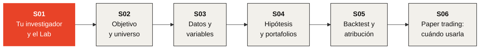

# Investment Bootcamp

### Construye una estrategia de inversión. Prueba bien la idea.

[English](https://github.com/KaxaNuk/Investment-Bootcamp/tree/english) · **Español**

---

En seis sesiones construyes una estrategia de inversión y pruebas la idea correctamente, **desde
una afirmación escrita hasta un veredicto por escrito**, con tu propio KaxaNuk Researcher a tu
lado. La promesa es probar bien una idea, nunca mejores rendimientos.

El Bootcamp es el primero de los KaxaNuk Training Workshops, abierto a todos. Quien empieza se
lleva una idea general del proceso de investigación y sus herramientas; quien ya sabe, las aprende
a fondo. **Golden-Flow** es el ejemplo, de principio a fin.

> [!IMPORTANT]
> **La S01 es en vivo el miércoles 2026-11-04 a las 10:00, hora de la Ciudad de México.**
> [Regístrate en Luma →](https://luma.com/houg6p99)

## 🗺️ El recorrido

## 📅 Cómo funciona

| | |
| --- | --- |
| 🎥 **En vivo** | Una sesión por semana, en línea, de 90 minutos |
| 📥 **Las slides** | La presentación de cada sesión se publica aquí la semana en que se da, en un solo archivo HTML |
| 🛤️ **Dos rutas** | Sin código, en el Investment Lab · o con código, en el KaxaNuk Strategy Template |
| 🤖 **Tu asistente** | Claude Code con plan de pago · Codex · Cursor · Copilot CLI · Antigravity |

## 🖥️ Abre las slides

> [!TIP]
> GitHub muestra un archivo HTML como código, no como slides. **Descárgalo y luego ábrelo.**

1. Haz clic en el archivo de la sesión, arriba en esta página, o en su enlace en la tabla de abajo.
2. Haz clic en **Download raw file**, la flecha de descarga ⤓ arriba a la derecha del archivo.
3. Abre el archivo descargado con doble clic. Se abre en **Chrome o Edge**, sin necesidad de
   internet.
4. Avanza con las **flechas del teclado**, con un **clic** o con un **clicker de presentación**.
   **F11** lo muestra en pantalla completa.

## 📚 Las seis sesiones

| | Sesión | Qué haces | Con qué te vas |
| :---: | --- | --- | --- |
| 🟥 | [**S01 · Crea tu investigador y aprende a usar el Lab**](S01%20Crea%20tu%20investigador%20y%20aprende%20a%20usar%20el%20Lab.html) **Disponible** | Instalas tu investigador y lo entrenas con papers. Conoces el Investment Lab y ves cada parte de una estrategia en Golden-Flow. | Tu investigador, con nombre · tu primera nota citada · una idea que probar |
| ⬜ | **S02 · El objetivo de tu estrategia y el universo invertible** Semana 2 | Empiezas tu estrategia, escribes su objetivo y eliges primero su benchmark. Construyes el universo como era en cada fecha, con las empresas que dejaron de cotizar. | Tu repositorio · tu `OBJECTIVE.md` · tu universo |
| ⬜ | **S03 · Obtención de datos e ingeniería de variables** Semana 3 | Descargas tus datos y construyes variables. Analizas una señal sola, antes de cualquier portafolio. | Tus datos · una señal que se queda o se va |
| ⬜ | **S04 · Escribe tu hipótesis y construye los portafolios históricos** Semana 4 | Guardas una hipótesis refutable antes de la regla. Construyes portafolios históricos solo con lo que se sabía cada día. | Tu blueprint · tu regla y su control |
| ⬜ | **S05 · Simula tus portafolios y atribuye su rendimiento** Semana 5 | Haces el backtest neto de costos contra el KN US Equity Core y SPY. Atribuyes cada punto a factores y sectores. | Tu historial · de dónde vino su rendimiento |
| ⬜ | **S06 · ¿Lista para paper trading? Valida, congela y presenta** Semana 6 | Analizas una estrategia en toda la ventana, por periodo y por factor. Decides cuándo usarla, a discreción o con una regla, y la congelas para paper trading. | Tu veredicto, por escrito · tu portafolio congelado |

## 💬 Preguntas

Pregúntale primero a tu investigador: dile *"voy en la S01 del Bootcamp"*. Luego escribe a
[workshops@kaxanuk.mx](mailto:workshops@kaxanuk.mx).

---

El Researcher, el Data Curator y el Strategy Template de KaxaNuk son open source; el
Investment Lab y el Analytics Factory son por suscripción. Nada aquí es una recomendación para
comprar, vender o mantener ningún valor. Los backtests son hipotéticos y dentro de muestra. El
material se comparte bajo CC BY 4.0; el nombre, el logo y el isotipo de KaxaNuk no.
